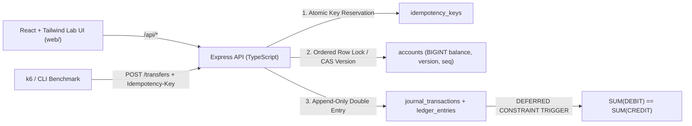
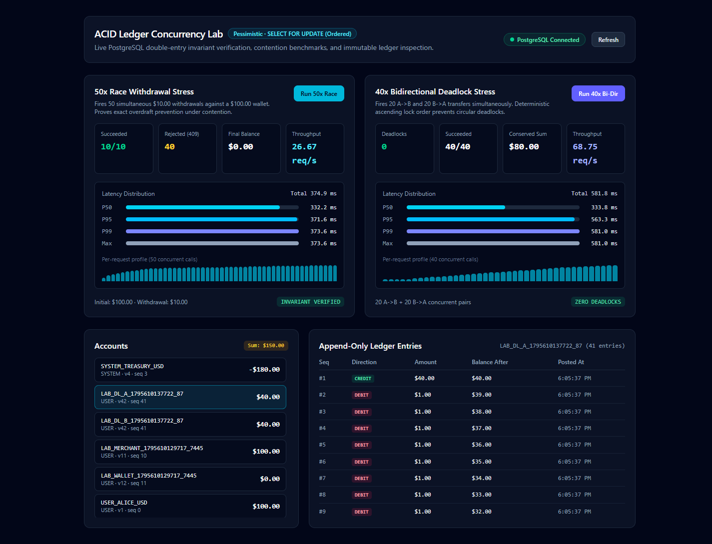

# ACID Ledger Concurrency Engine

[](https://github.com/shenalockersz/acid-ledger-concurrency-engine/actions/workflows/ci.yml)

A double-entry financial ledger service built in TypeScript and PostgreSQL to demonstrate database-enforced accounting invariants, pessimistic vs. optimistic concurrency control, deadlock-free lock ordering, and Stripe-style atomic idempotency keys, paired with an interactive React + Tailwind Concurrency Lab dashboard.

## Architecture Overview



## Concurrency Lab UI

An interactive dashboard in `web/` lets reviewers fire live concurrent contention tests against PostgreSQL and inspect the resulting latency distribution and immutable `ledger_entries` trail:



## Live PostgreSQL Verification Results (Local Docker Run)

### 1. Stress Lab Scenarios (`web/` UI + Express API)

| Benchmark Scenario | Concurrency | Outcome | Invariant Check | Throughput | Latency (P50 / P95 / Max) |
| :--- | :---: | :--- | :--- | :---: | :--- |
| **50x Race Withdrawal Stress** (`$100.00` wallet vs `50 x $10.00`) | 50 | `10/10` succeeded, `40` rejected (`409`) | Final balance `$0.00` (`INVARIANT VERIFIED`) | `26.67 req/s` | `332.2 ms / 371.6 ms / 373.6 ms` |
| **40x Bidirectional Deadlock Stress** (`20 A->B` + `20 B->A`) | 40 | `40/40` succeeded, `0` deadlocks | Conserved sum `$80.00` (`ZERO DEADLOCKS`) | `68.75 req/s` | `333.8 ms / 563.3 ms / 581.0 ms` |

### 2. Pessimistic vs. Optimistic Hot-Account Contention (`npm run bench:contention`)

50 concurrent transfers hitting a single shared hot account (`maxRetries = 5` on OCC):

| Strategy | Concurrency | Succeeded | Conflicts (`409`) | Avg Attempts | Throughput | Duration | Latency (P50 / P95 / Max) |
| :--- | :---: | :---: | :---: | :---: | :---: | :---: | :--- |
| **Pessimistic (`SELECT ... FOR UPDATE`, ordered)** | 50 | `50/50` | `0` | `1.00` | `63.96 req/s` | `781.80 ms` | `437.89 ms / 758.54 ms / 781.16 ms` |
| **Optimistic (`version` CAS + backoff)** | 50 | `16/50` | `34` | `4.31` | `36.10 req/s` | `443.19 ms` | `397.44 ms / 433.78 ms / 442.59 ms` |

**Takeaway:** Under 50-way contention on a single hot row, ordered pessimistic locking achieves **100% completion (`0` conflicts)** and **1.77x higher effective throughput** (`63.96` vs. `36.10 req/s`), whereas OCC burns an average of `4.31` attempts before exhausting its retry budget on 34 colliding writes. Both strategies preserved exact double-entry balance conservation (`0` unexpected errors).

### 3. Automated Verification Summary

- **Unit Suite (`npm test`):** `4/4` suites, `23/23` tests passing (validation, ordered locks, pessimistic, OCC retries, API routes, canonical SHA-256 idempotency)
- **Live PostgreSQL Integration Suite (`npm run test:integration`):** `1/1` suite, `6/6` tests passing against PostgreSQL 16 (deferred balance trigger rejection, append-only `ledger_entries` trigger, 50x race withdrawal, 40x bidirectional deadlock test, concurrent OCC conservation, and 10x concurrent `Idempotency-Key` race)

## Tech Stack

- **Backend & Language:** Node.js, TypeScript (strict mode), Express.js, Zod, Pino
- **Frontend:** React 19, TypeScript, Vite, Tailwind CSS
- **Database:** PostgreSQL 16 (`BIGINT` minor units, deferred constraint triggers, least-privilege `ledger_app` role)
- **Testing & Load:** Jest (unit + live PostgreSQL concurrency barrier tests), k6
- **Infrastructure:** Docker Compose, GitHub Actions CI

## Quickstart

```bash
cp .env.example .env
docker compose up -d
npm install
npm --prefix web install
npm run migrate
npm run seed
```

Run the API and Concurrency Lab UI in two terminals:

```bash
# Terminal 1 - Express API (defaults to PORT=3000; set PORT=3100 if 3000 is busy)
npm run dev:api

# Terminal 2 - Vite + React + Tailwind UI on http://localhost:5173
# If using PORT=3100 above, set API_PROXY_TARGET=http://localhost:3100
npm run dev:web
```

Run tests, contention benchmarks, and `k6` load tests:

```bash
npm test                  # Fast mocked unit suite
npm run test:integration  # Real PostgreSQL ACID & concurrency barrier suite
npm run bench:contention  # Pessimistic vs. Optimistic CLI benchmark
k6 run load-tests/transfer-contention.js
```

## Architecture Decision Records

- [ADR 001: Integer Minor Units and Database-Enforced Double-Entry Invariants](./docs/adr/001-integer-minor-units-and-double-entry.md)
- [ADR 002: Pessimistic Row Locking vs. Optimistic Concurrency Control](./docs/adr/002-pessimistic-vs-optimistic-locking.md)
- [ADR 003: Atomic Idempotency Keys for Retry-Safe Transfers](./docs/adr/003-atomic-idempotency-keys.md)

## Trade-Offs & Intentional Scope Boundaries

| Area | Current Scope | Production Next Step |
| :--- | :--- | :--- |
| **Currency Precision** | Single-currency `BIGINT` minor units per transfer | Add an FX rate ledger and rounding-remainder account for cross-currency swaps |
| **Idempotency Retention** | Rows retained indefinitely in `idempotency_keys` | Schedule TTL cleanup / partitioning (24-72h retention) |
| **Hot-Account Scaling** | Single row per account (`FOR UPDATE` or OCC) | Shard high-volume treasury/settlement accounts into sub-accounts with periodic rollup |
| **Auth & Observability** | `X-Tenant-Id` header + Pino JSON logs | Wire JWT verification and OpenTelemetry `traceparent` export |

## Build Roadmap

- [x] TypeScript service scaffold, strict ESLint config, and PostgreSQL Docker Compose setup
- [x] Double-entry schema, deferred balance triggers, append-only ledger rules, and idempotency table
- [x] Pessimistic locking (`SELECT ... FOR UPDATE`) with deterministic lock ordering
- [x] Interactive Express API + React/Tailwind Concurrency Lab dashboard
- [x] Optimistic concurrency control (OCC) strategy and hot-row contention benchmark
- [x] Atomic `Idempotency-Key` middleware (`200` replay, `409` in-flight, `422` payload mismatch)
- [x] Jest concurrency barrier suite (50x concurrent withdrawals, 20x bidirectional deadlock test)
- [x] `k6` contention script, GitHub Actions CI, and Architecture Decision Records (`docs/adr/`)
