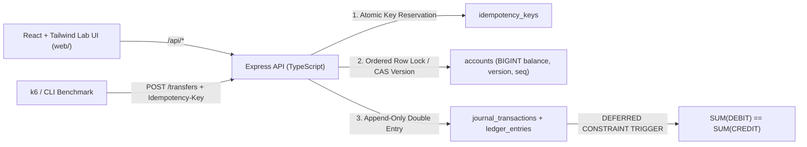

# ACID Ledger Concurrency Engine

A double-entry financial ledger service built in TypeScript and PostgreSQL to demonstrate database-enforced accounting invariants, pessimistic vs. optimistic concurrency control, deadlock-free lock ordering, and Stripe-style atomic idempotency keys, paired with an interactive React + Tailwind Concurrency Lab dashboard.

## Architecture Overview



## Concurrency Lab UI

An interactive dashboard in `web/` lets reviewers fire live concurrent contention tests against PostgreSQL and inspect the resulting latency distribution and immutable `ledger_entries` trail:


### Live PostgreSQL Verification Results (Local Docker Run)

| Benchmark Scenario | Concurrency | Outcome | Invariant Check | Throughput | Latency (P50 / P95 / Max) |
| :--- | :---: | :--- | :--- | :---: | :--- |
| **50x Race Withdrawal Stress** (`$100.00` wallet vs `50 x $10.00`) | 50 | `10/10` succeeded, `40` rejected (`409`) | Final balance `$0.00` (`INVARIANT VERIFIED`) | `26.67 req/s` | `332.2 ms / 371.6 ms / 373.6 ms` |
| **40x Bidirectional Deadlock Stress** (`20 A->B` + `20 B->A`) | 40 | `40/40` succeeded, `0` deadlocks | Conserved sum `$80.00` (`ZERO DEADLOCKS`) | `68.75 req/s` | `333.8 ms / 563.3 ms / 581.0 ms` |

## Tech Stack

- **Backend & Language:** Node.js, TypeScript (strict mode), Express.js, Zod, Pino
- **Frontend:** React 19, TypeScript, Vite, Tailwind CSS
- **Database:** PostgreSQL 16 (`BIGINT` minor units, deferred constraint triggers, least-privilege `ledger_app` role)
- **Testing & Load:** Jest (unit & concurrency barrier tests), k6
- **Infrastructure:** Docker Compose, GitHub Actions CI

## Quickstart

```bash
cp .env.example .env
docker compose up -d
npm install
npm --prefix web install
npm run migrate
npm run seed
```

Run the API and Concurrency Lab UI in two terminals:

```bash
# Terminal 1 - Express API (defaults to PORT=3000; set PORT=3100 if 3000 is busy)
npm run dev:api

# Terminal 2 - Vite + React + Tailwind UI on http://localhost:5173
# If using PORT=3100 above, set API_PROXY_TARGET=http://localhost:3100
npm run dev:web
```

Run tests and contention benchmarks:

```bash
npm test
npm run bench:contention
```

## Build Roadmap

- [x] TypeScript service scaffold, strict ESLint config, and PostgreSQL Docker Compose setup
- [x] Double-entry schema, deferred balance triggers, append-only ledger rules, and idempotency table
- [x] Pessimistic locking (`SELECT ... FOR UPDATE`) with deterministic lock ordering
- [x] Interactive Express API + React/Tailwind Concurrency Lab dashboard
- [x] Optimistic concurrency control (OCC) strategy and hot-row contention benchmark
- [ ] Atomic `Idempotency-Key` middleware (`200` replay, `409` in-flight, `422` payload mismatch)
- [ ] Jest concurrency barrier suite (50x concurrent withdrawals, 20x bidirectional deadlock test)
- [ ] `k6` contention script, GitHub Actions CI, and Architecture Decision Records (`docs/adr/`)
