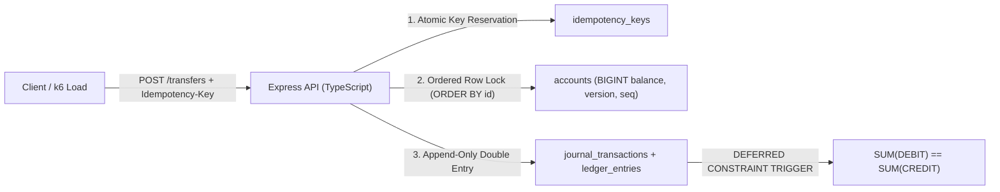

# ACID Ledger Concurrency Engine

A double-entry financial ledger service built in TypeScript and PostgreSQL to demonstrate database-enforced accounting invariants, pessimistic vs. optimistic concurrency control, deadlock-free lock ordering, and Stripe-style atomic idempotency keys.

## Architecture Overview



## Tech Stack

- **Runtime & Language:** Node.js, TypeScript (strict mode)
- **Database:** PostgreSQL 16 (BIGINT minor units, deferred constraint triggers, least-privilege `ledger_app` role)
- **Testing & Load:** Jest (containerized concurrency barrier tests), k6
- **Infrastructure:** Docker Compose, GitHub Actions CI

## Quickstart

```bash
cp .env.example .env
docker compose up -d
npm install
npm run migrate
```

## Build Roadmap

- [x] TypeScript service scaffold, strict ESLint config, and PostgreSQL Docker Compose setup
- [ ] Double-entry schema, deferred balance triggers, append-only ledger rules, and idempotency table
- [ ] Pessimistic locking (`SELECT ... FOR UPDATE`) with deterministic lock ordering
- [ ] Optimistic concurrency control (OCC) strategy and hot-row contention benchmark
- [ ] Atomic `Idempotency-Key` middleware (`200` replay, `409` in-flight, `422` payload mismatch)
- [ ] Jest concurrency barrier suite (50x concurrent withdrawals, 20x bidirectional deadlock test)
- [ ] `k6` contention script, GitHub Actions CI, and Architecture Decision Records (`docs/adr/`)
